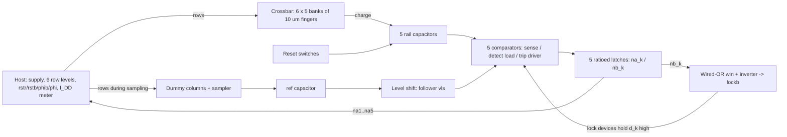

# Tortoise: concept, evidence, and limits

Tortoise is a design for a small classifier that would sit on a flexible foil next to a set of wound sensors and decide
which of five conditions the sensor readings look like. It is built, on paper, only from p-type organic thin-film
transistors (OTFTs), and it computes by letting five analog voltages race to a threshold. **Everything in this document
is simulation.** Nothing has been fabricated or measured, the transistor model is a reconstruction from published
data measured on silicon rather than on foil, and the data set is synthetic. A simulation cannot prove that hardware
will work; what follows is the idea, the evidence that it is plausible in simulation, and where that evidence stops.

**How the numbers are referenced.** Every number in this document is followed by a tag in square brackets. A tag such
as [FC-01] names a row of [`RESULTS_INDEX.md`](RESULTS_INDEX.md), which gives the sample size, the confidence interval,
the summary file the number is read from, the script that writes it and where the raw simulation data live. [spec] marks
a design or protocol constant of the Tortoise v1.0 specification ([`docs/SPEC.md`](docs/SPEC.md)); [prior art] marks
a figure quoted from a published work or a datasheet ([`results/wrapup/prior_art/PRIOR_ART.md`](results/wrapup/prior_art/PRIOR_ART.md)).
`tools/check_concept.py` checks every tagged number against its source and fails on any untagged number;
`tools/check_results_index.py` checks every index row against its summary file. Accuracies are "correct of N", with
invalid runs counted as wrong, and intervals are Wilson 95 %.

**Summary of the wrap-up studies (wrap-up studies; details in [`results/wrapup/REPORT.md`](results/wrapup/REPORT.md)).**
- *Supply-on mode under drift and spread:* a die at |V_th| 0.55 V that runs with its supply on classifies 15 of 20 at
  mobility ×1, ×0.7 and ×0.5; drifted by +0.10 or +0.20 V, it is moved to the gated mode by its next calibration and
  keeps 15 of 20; with size-scaled mismatch it reaches 65/100 [WU-01; WU-02; WU-04].
- *candidate-edgeA* (one transistor resized, 134 transistors): classifies down to |V_th| 0.47 V instead of
  0.51 V, with nominal outcomes identical on all 90 test samples and no dielectric over-stress [WU-11; WU-13; WU-14].
- *candidate-bias* (per-class bias row, 138 transistors): 63/90 on the test set against 62/90, a difference that
  is not resolvable (p = 1.0) [WU-23].
- *Prior art and the microcontroller question:* the race principle, time-domain weighted sums, winner-take-all
  classification and printed classifiers all have precedents; the specific p-only OTFT "integrate, then race" design
  was not found. An ultra-low-power microcontroller would do the whole job for an estimated 0.42 µJ (datasheet
  arithmetic), while Tortoise needs 0.59 µJ on the die and ≥ 1.79 µJ with the host it requires [WU-40; WU-41]. In the architecture simulated here Tortoise loses (§9).

---

## 1. The problem and the idea

**The problem.** Chronic wounds are monitored with chemical and physical sensors; research dressings already carry pH,
temperature, metabolite and impedance sensors and send their readings to a microcontroller or a phone (§8). Tortoise
asks a narrow question: could the *decision* — which of a few wound states the readings resemble — be made by a
circuit printed or evaporated on the same foil, from the same kind of transistors as flexible sensors, without a
silicon chip on the wound side?

The task used throughout is a synthetic "wound panel": six normalised inputs (pH, uric acid, lactate, temperature,
pyocyanin, impedance) and five classes (normal healing, acute inflammation, bacterial colonisation, biofilm formation,
a sepsis-like benchmark). The data are generated, not measured (the file's own metadata says `clinical_validation:
false`); 210 samples are used for training [WS-01] and 90 for testing [FC-01], split by synthetic acquisition batch.

**The constraints.** The target transistors are DNTT-family organic TFTs on a thin AlOx/SAM gate dielectric. They are
p-type only, run from one 3.3 V rail, and must not see more than 3.5 V across the gate dielectric [spec]. Their
threshold voltage and mobility drift and vary from device to device, and they are slow: tens of µm channel lengths and
mobilities of a few cm²/Vs give µs-scale time constants.

**The idea.** A linear classifier picks the class k with the largest score s_k = Σᵢ F[i,k]·xᵢ. Tortoise turns each score
into a voltage, then into a time, and lets the largest score win a race:
1. **Integrate.** Each class k has a "rail" capacitor. Each input i drives a row line for a time proportional to xᵢ, and
   the transistors connecting row i to rail k (a bank of F[i,k] identical 10 µm fingers [spec]) charge the rail for that
   time. After this phase the rail voltages are an affine function of the five scores.
2. **Race.** All rows are then driven to the same level. Every rail charges at the same rate (every class column has the
   same number of fingers, 60 [spec]), so the rail that started highest reaches the comparator threshold first.
3. **Latch and lock out.** The first comparator to trip sets its latch; the latch pulls a shared line that disables the
   other comparators. The host reads which of the five outputs is high.

The weights are integers fixed in the layout (finger counts). There is no clock on the die, no digital arithmetic and
no analog-to-digital converter: the "computation" is charge accumulation followed by a race.

## 2. How a time-race classifier computes

```
 row level                  C1 (integrate)                C2 (race)
 3.3 V ──┐ reset/ ┌─┐       ┌──────── x_i-long pulses ─┐   ┌───────────────────────── all rows at V2
         │ sample │ │ V1 ───┘  (20 + 170·k·x_i µs)     └───┘
 rail k  ▁▁▁▁▁▁▁▁▁▁▁▁▁▁▁▁▁▁▁▁▁▁╱‾‾‾‾‾‾‾‾‾‾‾‾‾‾‾‾‾‾‾‾‾‾‾‾‾‾‾╱‾‾‾‾‾‾‾‾‾‾‾‾‾‾ threshold Θ ‾ ‾ ‾ ‾ ‾
         (reset)               V_k grows with Σ_i F[i,k]·(20 + 170·k·x_i)      ╱ slope ∝ Σ_i F[i,k] = 60 for every k
 output                                                                       first rail at Θ → latch → lock others
```

With the integration-phase rail voltage V_k, a common race slope s and a common effective threshold Θ, the trip time
measured from the start of the race is t_k = (Θ − V_k)/s. The order of the trip times is the order of the rail voltages,
which is the order of the scores. The gap between the winner and the runner-up is their voltage difference divided by
the slope. In simulation this is very nearly exact: a lab-calibrated linear race model predicts the runner-up gap of
the 87 valid nominal runs with correlation r = 0.9999 [FC-06], and a model refitted on training runs called the winner
of 40 of 40 held-out training samples [WS-10].

Two things make the race imperfect:
- **Near ties.** If the runner-up trails by less than about G_res = 8.70 µs [WS-10], both latches set before the lock
  takes effect (a "double latch") and the run is invalid. The limit is the slow regeneration of the ratioed latch, not
  the lock latency, which is longer (median 19.2 µs [FC-04]) yet does not decide validity.
- **No per-class bias.** A general linear classifier has a score s_k = w_k·x + b_k. In the crossbar every class gets the
  same fixed pedestal (each row is on for at least 20 µs [spec]) and the same race slope, so there is no b_k. On the
  training data the best bias-free, equal-column-sum linear classifier reaches 67.9 % in cross-validation, against
  73.7 % for an unconstrained linear classifier [WS-02; WS-01].

## 3. The circuit, block by block, and why p-only

The Tortoise v1.0 die has 134 transistors [spec], one 3.3 V supply, ten host-driven lines (six rows and four timing lines)
and five outputs [spec].



| Block | What it does | Devices |
|---|---|---|
| Crossbar | bank (i, k) = F[i,k] fingers of 10 µm, L = 54 µm, from VDD to rail k, gate = row i; empty banks removed | 21 banks [spec] |
| Rails and reset | 5 rail capacitors; reset switches clamp the rails during reset | 5 switches [spec] |
| Reference | dummy columns driven by the rows during a short sampling window charge `ref`; a source follower makes `vls` | dummy columns, sampler, servo, level shift |
| Comparator (per class) | sense device (gate = rail, source = `vls`) against a detect load; its output `d_k` drives a trip driver | 3 per class [spec] |
| Latch (per class) | ratioed cross-coupled pair `na_k`/`nb_k` with long-channel loads; `na_k` is the output | 4 per class, plus a reset device [spec] |
| Lock | each latched class pulls the shared node `win` up; an inverter makes `lockb`; lock devices then hold every `d_k` high | one driver per class, inverter, lock devices |

**Why p-only, and what it costs.** The DNTT-family process the design targets offers p-type transistors only, so the
design uses ratioed logic: every "pull-down" is a p-type device with its gate at ground, which never turns fully on or
off. Four consequences shape the whole design:
- **Static current sets the energy.** Ratioed stages conduct whenever they hold a state. Of the 714 nJ a classification
  costs when the supply stays on, almost all goes to static bias and latch loads [EH-01], and a powered idle die draws
  98.2–198.7 µW [EH-03]. Switching the supply off between classifications (host protocol v2) brings the energy to
  588 nJ with zero standby [H2-02].
- **A narrow voltage window.** Without a negative supply, a gate-grounded reset cannot pull a rail below about one
  |V_th| and the comparator reference cannot sit above about VDD − |V_th|; the usable window shrinks roughly as
  VDD − 2|V_th|, so the design degrades as |V_th| rises ([`docs/DESIGN_LESSONS.md`](docs/DESIGN_LESSONS.md), lesson 2).
- **Mismatch becomes per-class offsets.** A rail's start level and a comparator's trip level are each set by one device's
  threshold, so those devices are made large (sense devices 468/15 µm, reset switches 400/20 µm [spec]).
- **A low-|V_th| edge.** A p-type "off" device whose gate cannot reach VDD is not fully off; at low |V_th| leakage
  through such devices moves internal idle levels until a latch or the lock-out misbehaves (§6, §7).

**The host.** The die cannot run alone. A host (a microcontroller-class device) supplies power, drives the six row
levels and the four timing lines with µs timing, times and reads the five outputs, and measures its own supply current
to calibrate the die (§5.6). The host also has to know the input values: it converts each xᵢ into a pulse length.

## 4. The device and its measured basis

All transistors are simulated with a charge-based compact OTFT model (subthreshold conduction, contact resistance,
bias-dependent gate capacitance; the crossbar banks use a 5-segment channel to capture channel transit). The device
corner, called `fitc10`, has band mobility 5.87 cm²/Vs, |V_th| 0.65 V, subthreshold swing 112 mV/dec, contact resistance
490 Ω·cm, and gate capacitance 0.70 µF/cm² [spec].

**Provenance and caveats** ([`docs/SPEC.md`](docs/SPEC.md) §1):
- The mobility, |V_th|, swing and contact resistance come from a published data set on **didecyl-DNTT (C10-DNTT)
  transistors on silicon** (Kraft et al., Organic Electronics 2016 [prior art], DOI 10.1016/j.orgel.2016.04.038), read from the
  published curves **by eye** (saturation currents ±0.3 µA [spec]). Devices on foil can differ.
- The gate capacitance is a lab value for the AlOx/SAM stack chosen by the author; the off-current density
  (1e-14 A/µm [spec]) and gate overlap (2 µm [spec]) were **not fitted** and are kept at lab values.
- The original fitted corner card and the netlist it was used with were **lost**; the card in the repository is a
  reconstruction from the values recorded in the campaign specification, and the circuit sizing for this corner ("Variant 3")
  was rebuilt from the author's recorded decisions, one of which was taken after seeing simulation results.
- No mismatch, bias-stress or aging data exist for this stack; every mismatch and aging result below rests on an
  assumed model (stated next to each number).

## 5. Evidence that it works in simulation

All results: ngspice-42 transients of the full netlist (134 transistors [spec]), Tortoise v1.0 (Variant 3 at `fitc10`, the
base-design weights, host protocol v2.1) unless stated. "The subset" is a fixed set of 20 test samples, 4 per class [spec].

### 5.1 Nominal accuracy
| Measure | Result | Ref. |
|---|---|---|
| Test accuracy, nominal die | **62/90 = 68.9 %** (58.7–77.5 %) | [FC-01] |
| Validity (exactly one latch, and it was the first) | 87/90 | [FC-02] |
| Same 90 runs under host protocol v2 (power-gated) | 62/90, outcomes identical on 90/90 | [H2-01] |
| Median race time from the start of the race (v2) | 1626 µs | [H2-03] |
| Retrained weights (scheme-A training), run once on the test set | 62/90; 6 gained, 6 lost, McNemar p = 1.0 | [WS-05; WS-07] |
| Training-data ceilings: unconstrained linear vs crossbar form | 73.7 % vs 67.9 % | [WS-01; WS-02] |

The three invalid nominal runs are near-tie double latches. The SPICE accuracy is at the software accuracy of the same
weights; retraining did not raise it, which points at the missing bias (§2), tested as a candidate in §5.7.

### 5.2 Dielectric stress
| Condition | Result | Ref. |
|---|---|---|
| 5 extreme runs, every TFT including the crossbar, supply on | 0 of 134 above 3.5 V; worst 3.339 V | [FC-07] |
| Power-up, classification, power-down and 1 s off (v2) | 0 of 134 above the limit; worst 3.300 V; internal nodes down to −2.20 V after power-down | [H2-05] |
| Power-up/down ramps from 100 µs to 1 µs | 0 above the limit at all 5 rates; worst 3.436 V at the 1 µs ramp | [V21-07] |

### 5.3 Threshold and mobility drift (aging proxies)
Aging is modelled as a uniform shift of |V_th| and a uniform mobility factor on the whole die (literature proxies, not a
measured aging model).
| Condition | Result | Ref. |
|---|---|---|
| +0.20 V drift, host levels **not** re-trimmed | 0/20 at every mobility | [EH-11] |
| Host protocol v2 (learned \|V_th\| and µ), 25 cells \|V_th\| 0.65–1.00 V × µ ×1–×0.5 | 351/500 = 70.2 % (66.05–74.04 %); every cell 13–15 of 20 | [H2-06; H2-07] |
| The host's own estimate error over those 25 cells | \|V_th\| −4.4 … +8.5 mV | [H2-07] |
| Wrap-up Study 1: die at \|V_th\| 0.55 V (supply-on mode W) with mobility ×1 / ×0.7 / ×0.5 | 15 / 15 / 15 of 20, all valid | [WU-01] |
| Wrap-up Study 1: the same die drifted by +0.10 or +0.20 V, re-calibrated by the host | switched to the gated mode in 6 of 6 cells; 15 of 20 in every cell | [WU-02] |
| Host estimate error over those 9 cells | \|V_th\| −1.0 … +10.9 mV; µ̂ −0.3 … +10.3 % | [WU-03] |

### 5.4 Device mismatch (assumed models)
Each point is 5 random dies × the 20-sample subset, N = 100 [FC-13].

| Model | Result | Ref. |
|---|---|---|
| Size-scaled V_th spread (σ inversely proportional to √area), anchor 20 mV | 64/100 (54.2–72.7 %) | [FC-13] |
| same, anchor 35 mV | 57/100 | [FC-14] |
| Flat σ_Vth 20 / 40 / 80 mV with mobility and contact spread on every device (worst-case bound) | 39 / 41 / 31 of 100 | [FC-15] |
| Size-scaled, anchor 20 mV, host protocol v2 | 64/100 | [H2-08] |
| Size-scaled, anchor 20 mV, the same 5 dies at \|V_th\| 0.55 V (supply-on mode W, wrap-up Study 1) | 65/100 (55.3–73.6 %), valid 98/100; paired with the v2 result: 1 gained, 0 lost, p = 1.0 | [WU-04] |

The result depends on the assumed model more than on anything else: there is no measured matching coefficient for this
stack.

### 5.5 Energy
| Condition | Result | Ref. |
|---|---|---|
| Supply left on, fixed 2500 µs window | 714 nJ per classification (median), plus 98.2–198.7 µW standby | [EH-01; EH-03] |
| Host protocol v2: supply switched off between classifications, early end | **588 nJ** (499–655 nJ), zero standby on the die | [H2-02] |
| One calibration session | ≈ 2.99 µJ | [H2-11] |

These are die energies only: the host, its line drivers and the current meter are not counted (§9).

### 5.6 The host protocol (v2.1)
The host never sees the die's true |V_th| or mobility. Once per die (and whenever a re-trim is wanted) it ramps all
rows with the rails clamped and records its own supply current against the row voltage; a three-point fit gives an
estimate V̂ of |V_th| and a mobility estimate µ̂ (the "a1" method). From them it sets the two row levels
V₁ = 3.3 − V̂ − 0.83 V and V₂ = 3.3 − V̂ − 0.25 V and stretches all integration times by k = clip(1/µ̂, 1, 2.5) [spec].
Between classifications it switches the supply off for 1 s ("mode G") unless V̂ < 0.600 V, in which case it keeps the
supply on ("mode W") [spec], because a gated die with a low |V_th| starts with stuck latches. It ends each race early, 50·k µs
after an output rises, and reads the outputs [spec].

| Lower-\|V_th\| behaviour under v2.1 (nominal mobility, the subset) | Result | Ref. |
|---|---|---|
| \|V_th\| 0.51, 0.53, 0.55, 0.57, 0.59, 0.61 V | 15/20 at every point | [V21-01] |
| \|V_th\| 0.49 V | 0/20 (16 timeouts, 4 no latch) | [V21-02] |
| Standby paid by mode-W dies | 174–209 µW | [V21-04] |
| Mode W at 0.55 V under mobility loss (×1 / ×0.7 / ×0.5) | 15 / 15 / 15 of 20; standby 183.1 / 146.4 / 116.4 µW | [WU-01; WU-05] |

### 5.7 Candidate variants from the wrap-up study (not part of Tortoise v1.0)
**These are candidates from the wrap-up study, not part of Tortoise v1.0.** Adopting either is the author's decision.

**candidate-edgeA: moving the low-|V_th| edge.** Tortoise v1.0 fails at |V_th| 0.49 V [V21-02]. The stored node voltages of
all 20 subset samples show why: the shared lock node `win` idles at 2.445 V instead of 2.068 V at 0.51 V, so the lock
inverter's output falls to 2.228 V (2.888 V at 0.51 V) and the lock devices see 1.072 V of gate drive (0.412 V at
0.51 V) — the lock-out is partly on before any class has won, and the leading latch output never rises past 1.584 V
(median) [WU-10]. The idle level of `win` is set by five leaky pull-ups against one weak pull-down, which the `fitc10`
resize had made six times longer. The candidate shortens that one transistor back (W 5 µm [spec]; L 120 → 20 µm) [WU-11]: no
device added, 134 transistors [WU-14].

| Measure (v2.1, the subset unless stated) | candidate-edgeA | Tortoise v1.0 | Ref. |
|---|---|---|---|
| \|V_th\| 0.45 / 0.47 / 0.49 / 0.51 / 0.65 V | 0 / 15 / 15 / 15 / 15 of 20 [WU-11] | 0.49 V: 0/20 [V21-02]; 0.51 V: 15/20 [V21-01] | |
| All 90 test samples, nominal die | 62/90, outcomes identical on 90/90 [WU-13] | 62/90 [H2-01] | |
| Stress audit | 0 of 134 above 3.5 V; worst 3.300 V [WU-14] | worst 3.300 V [H2-05] | |
| Supply-on standby at 0.47–0.51 V | 196.0–204.0 µW [WU-15] | 174–209 µW [V21-04] | |

The edge moves from between 0.49 and 0.51 V to between 0.45 and 0.47 V. At 0.45 V the lock stays off but the latch
regenerates too slowly for the host's early-end window, a second mechanism this fix does not address. A second
candidate that halves the leakage instead (the five pull-ups made twice as long) also classified 15/20 at 0.49 V
[WU-12]; its lower points were not run.

**candidate-bias: a per-class bias row.** Section 2 identified the missing per-class bias as a likely accuracy limit. The candidate
adds a seventh, host-driven row with one bank per class, pulsed at the integration level for a fixed part of the
integration window; it costs 4 transistors (138 instead of 134) and one more host line [WU-27]. Its weights were trained on
the training samples only, with the race model refitted on 40 training runs of the new circuit (winner agreement 40/40,
rail residual 0.12 mV) [WU-20], and frozen before the single test-set run.

| Measure | candidate-bias | Tortoise v1.0 | Ref. |
|---|---|---|---|
| Test accuracy (90, run once) | 63/90 = 70.0 % (59.9–78.5 %) | 62/90 | [WU-23] |
| Paired per test sample | 9 gained, 8 lost, McNemar p = 1.0: **no resolvable change** | — | [WU-23] |
| Validity | 85/90 | 87/90 | [WU-24] |
| Size-scaled mismatch, 20 mV, the first 3 dies (N = 60) | 40/60 | 40/60 | [WU-25] |
| Stress audit | 0 of 138 above 3.5 V; worst 3.300 V [WU-26] | 0 of 134 [H2-05] | |
| Energy per classification (median) | 575 nJ [WU-27] | 588 nJ [H2-02] | |
| Yield under a simple 0.98^N model | ×0.922 relative to Tortoise v1.0 | — | [WU-27] |

On training data the bias row was worth about 2 points in cross-validation (68.2 % without it, 70.3 % with it, under
the same refitted race model; a post-hoc comparison) [WU-28], far less than the gap between the float ceilings (73.7 % vs 67.9 %)
[WS-01; WS-02] and well below what 90 test samples [FC-01] can resolve. In simulation it costs nothing in stress or energy, but
it is not shown to be better.

## 6. The operating envelope

Under v2.1, with no mismatch, the die classified the 20-sample subset at 13–15 of 20 over |V_th| 0.51–1.00 V at µ ×1 and
over |V_th| 0.65–1.00 V at every tested mobility from ×1 to ×0.5 [V21-01; H2-06]. It fails at 0.49 V [V21-02].
The wrap-up study adds, under v2.1 with no mismatch: a die at |V_th| 0.55 V keeps working in the supply-on mode at
mobility ×0.7 and ×0.5 (15 of 20 each) [WU-01], and a die that drifts by +0.10 or +0.20 V is moved to the gated mode by
its next calibration and keeps 15 of 20 [WU-02]; with size-scaled mismatch at 0.55 V it reaches 65/100 [WU-04].
Not simulated under v2/v2.1: \|V_th\| above 1.00 V, mismatch combined with drift, mismatch at the 35 mV anchor or
flat-σ models, idle lengths other than 1 s [spec]; supply noise and temperature were never modelled.

## 7. What was learned along the way

**From an earlier design iteration to the current design: the placeholder model.** An earlier design iteration was designed and checked with a Level-1 MOSFET card that had no
subthreshold conduction, no contact resistance and essentially no gate capacitance. With the real thin, high-capacitance
dielectric the gate capacitance is far larger, so every block whose timing or charge budget depended on it was wrong:
under a charge-based OTFT model that iteration's netlist did not classify, and its bootstrapped negative rails over-stressed
the dielectric ([`docs/DESIGN_LESSONS.md`](docs/DESIGN_LESSONS.md), lesson 1). The current design was a redesign: no negative
supply, a host-timed "integrate, then race" scheme, and larger devices where mismatch matters. The transferable lesson
is to check, before trusting any simulated design, that the transistor model has the gate capacitance and subthreshold
behaviour of the real device.

Other lessons, with their evidence:
- **Re-trim is mandatory, and the die can be measured by its own supply current.** Fixed levels fail outright after a
  +0.20 V drift [EH-11]; re-trimmed from the host's own estimate, all 25 drift cells classify at 13–15 of 20 [H2-06; H2-07].
- **Near ties, not lock latency, limit validity** [WS-10; FC-04].
- **Accuracy is limited by the architecture, not by the weights** [WS-01; WS-02; WS-05]; adding the missing bias term as
  a hardware row did not resolvably change test accuracy either [WU-23], so the limit may lie as much in the data as in
  the form.
- **Static current, not switching, sets the energy; gating time is the lever** [EH-01; H2-02].
- **Power gating has side effects:** internal latch nodes go negative after power-down and stay there [H2-05].
- **State the mismatch model:** the same circuit gives 31–41 % or 57–64 % depending on whether the threshold spread is
  assumed flat or area-scaled [FC-15; FC-13; FC-14].
- **A half-engaged lock-out sets the low-|V_th| edge** (wrap-up Study 2): at 0.49 V [V21-02] the idle level of the shared
  lock node rises with transistor leakage until the lock-out is partly on before any class has won, which holds every
  comparator output high. The fix is a sizing change of one pull-down (§5.7). The general lesson for ratioed unipolar
  logic: check idle levels of shared nodes against the lowest expected |V_th|, not only the active swings.
- **Count the host.** A classifier that needs a host to digitise its inputs, generate µs pulses and measure its own
  current cannot beat the host doing the computation itself (§9).

## 8. Prior art and novelty
A targeted literature search (logged API lookups, abstracts only; details and DOIs in
[`results/wrapup/prior_art/PRIOR_ART.md`](results/wrapup/prior_art/PRIOR_ART.md)) found the following closest work.
It is not a systematic review.

| Area | Closest work found | What Tortoise shares / does differently |
|---|---|---|
| Printed and flexible ML classifiers | printed bespoke digital and analog classifiers with hardware-aware training (Tahoori and Zervakis groups, 2020–2024 [prior art]); a hardwired ML engine of about a thousand gates in commercial metal-oxide TFTs on a flexible substrate (2020 [prior art]); a flexible 32-bit microprocessor (2021 [prior art]) | Same goal (classify on flexible substrates); those are fabricated or digital; Tortoise is an analog time race in p-type OTFTs and is not fabricated |
| Organic computing on foil | an 8-bit organic microprocessor on plastic foil (2012 [prior art]); organic electrochemical synapses and neurons (2017, 2022 [prior art]) | Organic circuits that compute exist; none found that classifies by a race |
| Time-domain and race computation | race logic (2014 [prior art]) and race-tree classifiers (2019 [prior art]); time-domain vector-matrix multipliers and pulse-width weighted sums in CMOS (2019, 2021 [prior art]); VMM + winner-take-all analog classifiers in CMOS (2014 [prior art]); a simulated TFT winner-take-all circuit (2021 [prior art]); time-to-first-spike learning (2018 [prior art]) | The race principle and the integrate-then-compare readout are known; Tortoise combines them in one unipolar OTFT circuit |
| Unipolar organic analog circuits | a ΔΣ ADC in p-type organic TFTs on foil (2011 [prior art]); a 3.3 V current-steering DAC in p-type OTFTs (2012 [prior art]); the pseudo-CMOS design style for monotype TFTs (2011 [prior art]) | p-only analog design at 3.3 V [prior art] is established; Tortoise adds no new device technique |
| Wound sensing | dressings with pH, temperature or multiplexed electrochemical sensors and a microcontroller or wireless link (2018–2023 [prior art]); a chip-free bandage tag classified off-patch by a neural network (2022 [prior art]) | The processing in published dressings is a microcontroller or off-patch; no on-foil classifier was found |

**Novelty, stated plainly.** Not new: racing signals to compute, time-encoded inputs integrated on a capacitor,
winner-take-all classification, classifiers for printed and flexible electronics, unipolar organic analog circuits and
sensor-laden wound dressings — each has published precedents. Possibly new, because the search did not find it: the
specific combination of an "integrate, then race" linear classifier with a latch lock-out in a single-gate, p-type-only
OTFT circuit at 3.3 V [spec] without a negative supply, together with a host that learns the die's threshold voltage and
mobility from its own supply current and re-trims levels and timing. Unclear: whether that combination has been
published somewhere the search did not reach, and whether it has any value in hardware, since nothing has been built.

## 9. Why not a microcontroller?
The honest answer is that, in the architecture simulated here, **a microcontroller is better on every axis compared here**.
The arithmetic, from datasheet typicals (two ultra-low-power MCUs) and the simulated Tortoise numbers, is in
[`results/wrapup/scripts/s4_mcu.py`](results/wrapup/scripts/s4_mcu.py):

| | Ultra-low-power MCU alone | Tortoise + its host |
|---|---|---|
| Energy per classification (wake-up, 6 ADC conversions, 6 × 5 classifier) | 0.42 µJ (0.26–1.03 µJ over 500–3000 assumed cycles); a second MCU 0.41 µJ [WU-40] | die 0.59 µJ, plus a host that must stay awake for the median 2194 µs read time (≥ 1.09 µJ idling in LPM0): ≥ 1.79 µJ, about 4.3× the MCU [WU-41] |
| Standby | 2.94 µW in LPM3, 0.048 µW in LPM4.5 [WU-43] | zero on the die [H2-02], but the host's standby is the same as on the left |
| Accuracy | any classifier the data support; an unconstrained linear one reaches 73.7 % in training CV [WS-01] | 62/90 = 68.9 % [FC-01], limited by the missing bias |
| Size | a complete MCU in a 5.36 mm² package [WU-42] | ≥ 1.89 mm² of transistor channels and capacitors alone, before routing and pads [WU-42], plus the host |
| Interconnect | the six sensor lines | ten driven lines, five outputs and a supply between host and foil [spec] |

**Where Tortoise loses.** The host must digitise the six inputs anyway (it turns each value into a pulse width), drive
two analog levels with µs timing, measure its own supply current and watch five outputs for the whole race. A
microcontroller that has already digitised the inputs can compute the whole linear classifier in a fraction of that
time and energy, with better accuracy, reprogrammable weights and no calibration. Tortoise therefore adds energy,
interconnects and complexity to a system that already contains the processor it was meant to replace.

**When a foil classifier could still make sense — arguments, not results.** (1) If the sensors drove the rows
directly (sensor-to-time or sensor-to-current conversion on the foil), the ADCs and host-generated pulses would
disappear and the foil-to-host link could shrink to a supply, a start line and a few outputs. (2) A disposable wound
dressing could carry only printed or organic parts, with the rigid MCU, battery and radio in a reusable unit outside
the dressing; few, simple contacts across that boundary might matter more than nanojoules. (3) Nothing rigid on the
wound side; conformal, thin, possibly transparent electronics. (4) Unit cost, if the process is printed at volume.
None of these is simulated or shown here; the first needs circuits and sensors this project does not have.

## 10. Limitations: what is not shown
- **No hardware.** Nothing was fabricated or measured. Every number is an ngspice-42 simulation of a compact model.
- **The device corner is a reconstruction** from data on silicon, read by eye, with two parameters not fitted and the
  original card lost (§4). Absolute times are model-dependent; orderings and gaps are the more robust outputs.
- **Synthetic data, small N.** 90 test samples give an interval of 58.7–77.5 % around 68.9 % [FC-01]; most robustness
  points use the 20-sample subset [V21-01], where a single sample moves the accuracy by five points. Nothing here says
  anything about real wounds.
- **Assumed mismatch and proxy aging** (§5.3–5.4). No measured matching or bias-stress data exist for this stack.
- **Ideal host and environment:** noise-free current meter and timer, ideal line drivers, 1 mV level resolution [spec]; no
  layout parasitics, IR drop, noise, pads, ESD, temperature or humidity.
- **No sensors.** The inputs are numbers the host turns into pulses; no sensor front-end exists.
- **The design constants of the host** (offsets of its estimators) come from the same model they correct.
- **Wrap-up candidates** (§5.7) were evaluated on 20-sample subsets per |V_th| point [V21-01], one assumed mismatch model, and
  a reduced selection set; two container restarts forced documented scope cuts (fewer variants, finalists, mismatch
  dies). None of the candidates has been through the full Tortoise v1.0 campaign set (drift grid, mode-W chains, ramp
  rates).

## 11. The path to hardware: a first fabrication experiment
A full die is not the right first step. The proposed first test structure is **one class column with its comparator,
latch and lock path**, plus device and matching test structures, on the target stack (DNTT-family OTFTs, AlOx/SAM
dielectric) on foil:

```
 6 row pads ──┬─ bank 1 ─┐                       ref pad (host-driven, replaces the dummy columns)
              ├─ bank 2 ─┤                          │
              ├─  ...   ─┼── rail (probe pad) ── comparator (sense / detect load / trip driver) ── latch (na/nb, out pad)
              └─ bank 6 ─┘        │                                                          │
                            reset switch (rstr pad)                     win node + inverter + lock device (probe pads)
```

| Measure | How | Simulated prediction it tests | Ref. |
|---|---|---|---|
| Device corner: µ, \|V_th\|, swing, contact resistance, gate capacitance | transfer/output curves and C–V on single TFTs of the crossbar, sense and load geometries | the `fitc10` values (5.87 cm²/Vs, 0.65 V, 112 mV/dec) | [spec] |
| Integration linearity | pulse one row for known times, read the rail | rail voltage linear in finger·time; the race model's gap correlation r = 0.9999 | [FC-06] |
| Comparator trip and latch regeneration | ramp the rail through the threshold; two columns with a programmable time offset | near-tie limit near G_res = 8.70 µs; lock latency ≈ 19.2 µs | [WS-10; FC-04] |
| Supply-current calibration (a1) | ramp the rows with the rail clamped, record I_DD | the host's \|V_th\| estimate within −4.4 … +8.5 mV of the true value | [H2-07] |
| Idle `win` / `lockb` level vs \|V_th\| | on dies (or after bias stress) spanning low \|V_th\| | the 0.49 V failure mechanism (lock half on at low \|V_th\|) | [V21-02] |
| Mismatch | arrays of identical pairs at the sense, reset and bank geometries | whether σ_Vth scales inversely with √area (64/100) or is flat (31–41 of 100) | [FC-13; FC-15] |
| Dielectric stress and drift | bias-stress the worst-case devices at their simulated peak | no device above 3.5 V; drift of \|V_th\| and µ under use | [FC-07; spec] |

What would refute the concept at this stage: a non-linear or strongly history-dependent integration, a latch that
cannot resolve gaps of a few tens of µs, a supply-current estimate that misses |V_th| by more than the level
tolerance, or σ_Vth closer to the flat model. What would support it: a single column that integrates linearly, trips
reproducibly and is calibrated by its own supply current. Only then is a full five-class die worth fabricating.

## 12. Open questions
- Can the sensors drive the rows directly (sensor-to-time), so that the host no longer has to digitise the inputs?
  Without that, §9 stands.
- What are the real mismatch and bias-stress drift of this OTFT stack, and do they look like the assumed models?
- Is the "integrate, then race" scheme accurate enough on real data? The synthetic data cap what can be said here, and a
  per-class bias row did not resolvably raise test accuracy (§5.7).
- Can a pseudo-CMOS or otherwise less ratioed latch cut the static current and the near-tie limit?
- What happens over many thousands of classifications, with temperature, humidity and supply noise?
